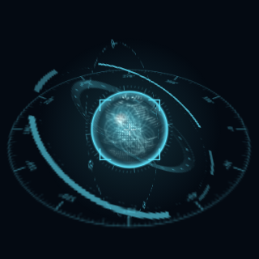
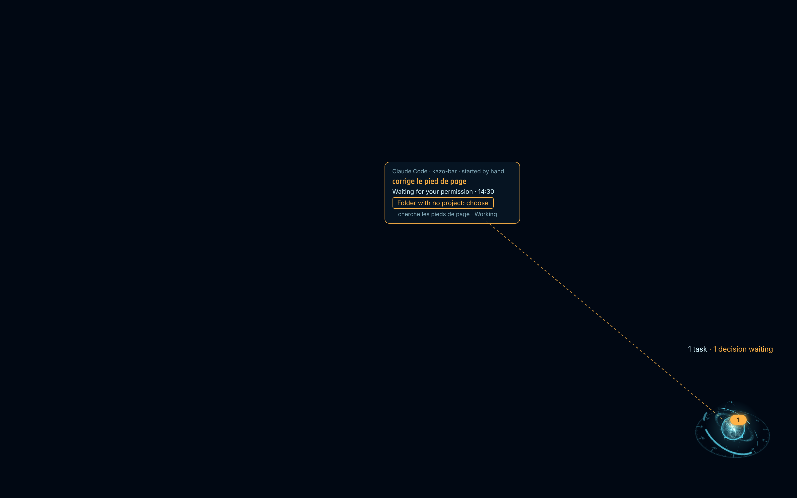
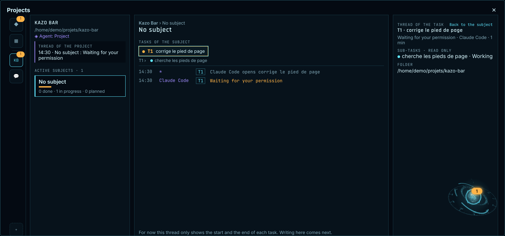

# Kazo.Jarvis

*[Version française](readme-fr.md)*

A voice assistant for Windows, written in C# on .NET 10, with no Python at run
time. It shows as an animated orb, answers first with a local model, and hands
off to Claude when a task is beyond it. An Android app lets you talk
to it away from the PC.

> **Under design.** Kazo.Jarvis is still being designed and built. Nothing is released, and what is built
> changes from one week to the next. Stage 1 (voice chain, orb, settings) and most of stage 2 (tools, memory,
> Claude Code sessions, task fan, agents, projects) are written; much of stage 2 has not run on Windows yet.
> See the [product overview](doc/en/features.md) for the state of each feature.

Build and test: [doc/en/dev/build.md](doc/en/dev/build.md).

## Screenshots

Taken on the test host, whose services are simulated ([how](design/screenshots/README.md)).

| The orb | The task fan (right click on the orb) |
| --- | --- |
|  |  |

The projects view (double click on the orb): a project, its subject, the band of tasks and the thread of a task.

## More

- Design document: [doc/en/dev/plans/design.md](doc/en/dev/plans/design.md)
- Product overview: [doc/en/features.md](doc/en/features.md)
- Technical spikes: [spikes/](spikes/README.md)
- UI designs and prototypes: [doc/en/dev/ui/catalog.md](doc/en/dev/ui/catalog.md), [design/](design/README.md)
- Rules for contributors and coding agents: [AGENTS.md](AGENTS.md)
- License: [Apache 2.0](LICENSE)
