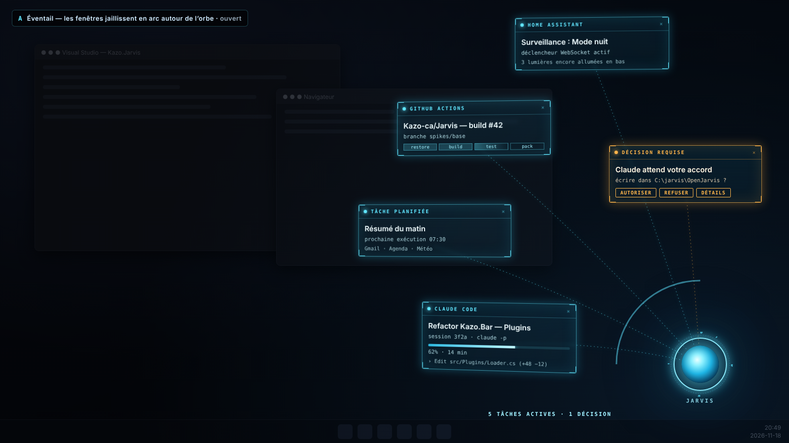
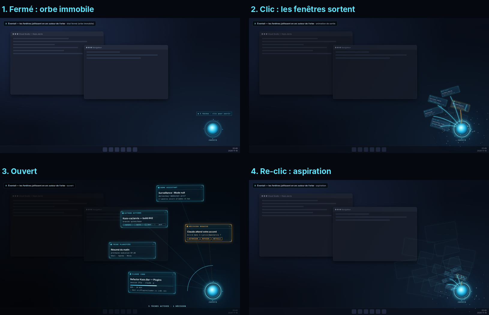
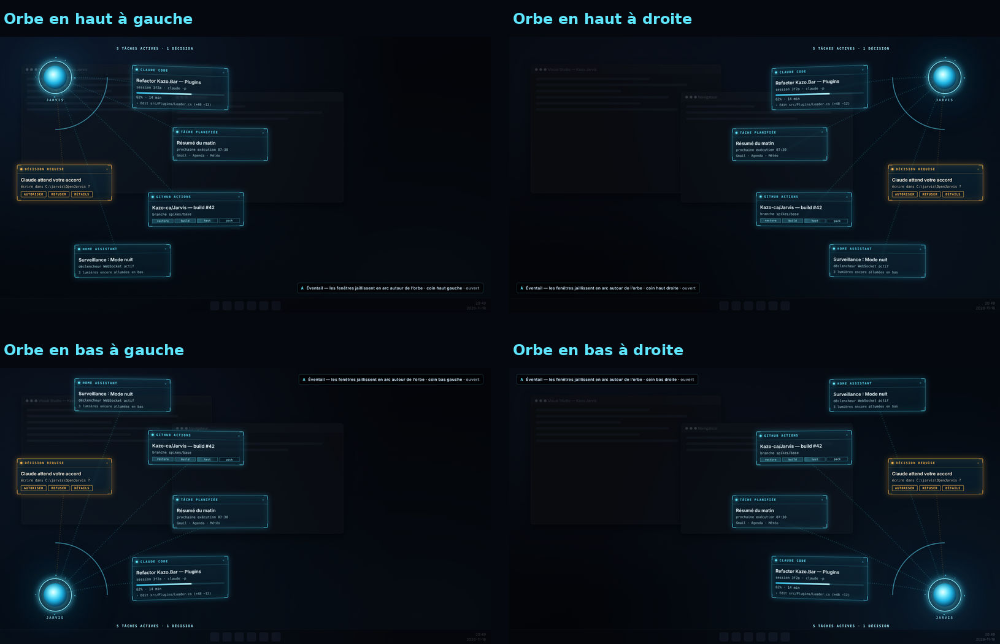

# ADR 0010: task fan and click on the orb

## Status

Proposed on 2026-11-19 (work item `spikes/12-task-fan-adr`). Waiting for Benoit's approval.

- **Sources:** Benoit's request of 2026-11-19 (a click on the orb makes the windows of the running tasks
  come out like a hologram, a second click pulls them back in); his choice of the same day between three
  mockups (fan, orbit, projection): **the fan**, on the computer only, with the orb in any corner of the
  screen; his answer of the same day about the click: "Double click, ouvre l'éventail. Simple click, écoute"
  (double click opens the fan, single click listens); decisions 4, 15, 18, 24 and 29 of the
  [design](../plans/design.md); stories US1.1, US1.6, US1.12, US2.9, US2.11, US2.15 and US3.2; spike E6
  ([results](../../../../spikes/e6-orb-window/RESULTS.md)).
- **Completes:** [ADR 0005](0005-assistant-state-machine-and-orb-contract.md) (adds the double click to
  the outputs of the orb; its transition table does not change),
  [ADR 0003](0003-hosts-and-native-services.md) (windows of the Windows host) and
  [ADR 0009](0009-permission-and-confirmation-model.md) (confirmation request).

## Context

- From stage 2, Jarvis runs tasks in the background: Claude Code sessions, then scheduled and delegated
  tasks. The orb shows how many with satellites (ADR 0005), not what they are.
- Benoit wants to see these tasks by clicking the orb, in a futuristic display. Three mockups were shown to
  him. He first picked the projection, then the fan.
- ADR 0005 says a click on the orb activates listening (US1.6). Its section 7 refers what a click does
  beyond activation to this ADR.
- Spike E6: in a transparent WPF window, every changed frame is copied by the processor. The idle budget is
  under 2 % of one core. The fan covers a much larger area than the orb: its cost is not measured.
- ADR 0009 shows a confirmation request near the orb, with Approve and Refuse buttons. A click on the PC is
  a strong channel there.

## Decision

### 1. The fan

The mockups are in French.

- **Opening.** On a double click on the orb, the panels of the running tasks shoot out of the orb and settle
  in an arc around it, one panel per task. A dotted line links each panel to the orb.
- **Closing.** A second double click on the orb pulls the panels back into the orb.
- **Dimmed desktop.** While the fan is open, the desktop behind it is dimmed.
- **Hues.** Panels are cyan. A panel waiting for a decision is **amber**, and so is its line.
- **Counter.** Near the orb, one line gives the number of tasks and the number of pending decisions.
- **Position.** The orb can be in any of the four corners of the screen (Benoit's clarification of
  2026-11-19). The fan always opens toward the center of the screen. The orb moves freely (US1.1): away
  from a corner, the fan takes the layout of the nearest corner.
- **With no running task**, the fan still opens and says so in one line.

### 2. The panels

- A panel shows one task: where it comes from, its title, its state and its latest activity.
- The panels of the mockup are examples. The panel types and their exact content are set by the ADRs of
  stages 2 and 3, with the slices that produce the tasks.
- **Decision panel.** It is the confirmation request of ADR 0009, shown in the fan: its summary, the
  Approve and Refuse buttons, and a Details button that shows the exact detail (path, command,
  differences). A click on these buttons is a click on the PC, so a strong channel. The fan adds no other
  way to approve, and the request also stays shown near the orb when the fan is closed.
- Panels are not Windows windows. They are drawn together, in a single surface.

### 3. Single click and double click on the orb

- **A single click on the orb keeps the behavior of ADR 0005**: it starts listening, cancels it or
  interrupts Jarvis (US1.6, US1.12). The transition table of ADR 0005 does not change.
- **A double click on the orb opens the fan. A second double click closes it.**
- A double click is never also a single click: it does not start listening and does not interrupt Jarvis.
  For that, the orb waits for the Windows double-click time (half a second by default) before handling a
  single click. The wake word and the hotkey are not delayed.
- The orb component gains a "double click" output, next to the click and the start of a move (ADR 0005,
  section 5). The delay is given to it by the host.
- **Until the fan is built**, there is no double click and no delay: the single click acts at once.
- The fan also closes with the Escape key and with a click on the dimmed desktop.
- **The fan is not an assistant state.** Open or closed, it changes neither the phase nor the conditions of
  ADR 0005. Jarvis can listen, think or speak while the fan is open, and the orb keeps its look.

### 4. On the computer only

- The fan exists in the Windows host.
- The Web test host shows it over the page, with simulated tasks: this is where Playwright checks it.
- On mobile, there is no fan. How tasks are shown on the phone is set by the mobile ADR, at stage 4.

### 5. In the Windows host

- The orb window stays small, as ADR 0003 says. It is not enlarged for the fan.
- The fan has its own window: transparent, borderless, topmost, on the screen the orb is on. The orb stays
  visible above it.
- **Closed, the fan costs nothing**: no drawing, no timer. The idle budget of ADR 0005 is measured with the
  fan closed and does not change.
- The fan is a slice of its own, separate from the orb slice. It receives the orb double click and the task list
  through kernel messages (ADR 0002). Its native contract (open and close the fan window) is added when the
  slice is built.

### 6. Animation

| Situation | Rule |
| --- | --- |
| Opening and closing | Animation, at most 30 frames per second, under one second to start with. The duration is tuned on the real host. |
| Fan open | **Still frame.** No continuous effect: no scan line, no floating panels. |
| A task changes (progress, new state, new task) | The panel concerned is redrawn once, at most once per second to start with; the interval is tuned by measurement. |
| Reduced motion | No animation: the fan appears and disappears at once. |

### 7. A spike before building

- The cost of a transparent window this large is not measured. A spike (E11) measures it at the start of
  stage 2, with the method of spike E6:
  - the cost during opening and closing, and how smooth the animation is;
  - the delay between the double click and the first frame;
  - the cost with the fan open and still, then with the fan closed;
  - click-through: on a panel, on the dimmed desktop, on the orb;
  - how the single click feels, delayed by the double-click time.
- The spike also says whether the window is created at each opening or kept hidden.
- If the animation does not hold on the real host, a new ADR says what to change before building.

### 8. When

- The fan is built at stage 2, with the first background tasks (US2.9, US2.11).
- Stage 1 builds none of it.

### 9. What this ADR does not decide

- **The colors and the drawing of the orb itself** (its six looks). The orb of the mockups is indicative.
  The orb ADR, still to be written, also sets the exact values of the cyan and the amber, and makes sure the
  amber of a decision cannot be mistaken for the alert hue of the "error" look.
- **How the closed orb signals a pending decision.** ADR 0005 plans satellites; the mockup shows a label
  "5 tâches · clic pour ouvrir" (5 tasks, click to open).
- **The ✕ of the panels** in the mockup: close the panel, or cancel the task.
- **What to do when the panels do not all fit in the arc.** The mockup shows five.
- **The other screens**, when there are several.

## Consequences

- Story US1.6 and decisions 15 and 18 of the design do not change: a single click still activates
  listening and still interrupts Jarvis.
- From stage 2, activation by click is delayed by the double-click time (half a second by default). The
  wake word and the hotkey stay immediate.
- The mockups say "clic pour ouvrir" (click to open) and "clic pour ranger" (click to close): read "double
  click".
- The Windows host has a second transparent window to maintain, and one more native contract with its two
  implementations.
- A critical action (ADR 0009) can be approved from the amber panel: it is a click on the PC.
- **Risk:** if spike E11 shows that the animation costs too much or stutters on a large transparent window,
  the effect will have to be reduced.
