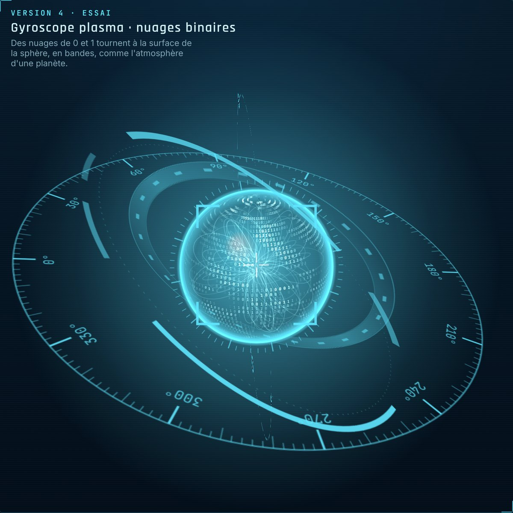
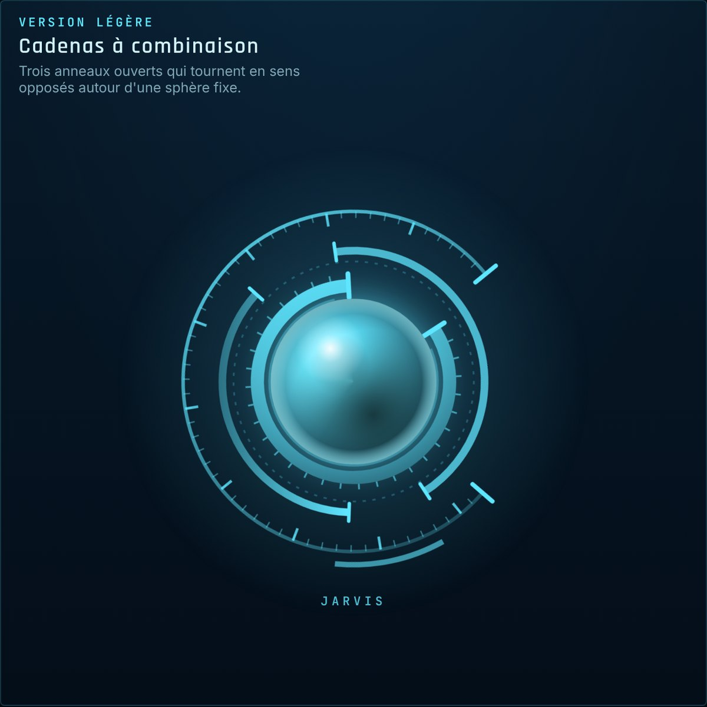

# ADR 0011: look and colors of the orb

## Status

Proposed on 2026-11-19 (work item `spikes/14-orb-adr`), waiting for Benoit's approval.

- **Sources:** designs validated by Benoit on 2026-11-19 and described in the
  [UI catalog](../ui/catalog.md) (high-quality orb: "c'est parfait"; light orb from his sketch: a core and
  three open rings); prototypes [`orb-high-quality.html`](../../../../design/prototypes/orb-high-quality.html)
  (mode 5) and [`orb-light.html`](../../../../design/prototypes/orb-light.html); what Benoit dislikes (size
  pulsing that follows the voice, speaking ripples); decisions 5 and 6 of the [design](../plans/design.md);
  spike E6 ([results](../../../../spikes/e6-orb-window/RESULTS.md)).
- **Completes:** [ADR 0005](0005-assistant-state-machine-and-orb-contract.md), which refers "the colors and
  drawing of the orb" to a dedicated ADR (section 7), and [ADR 0010](0010-task-fan-and-orb-click.md), which
  refers the values of the cyan and the amber and the signal of a pending decision here (section 9).
- **Supersedes:** a single sentence of ADR 0005, section 5: "It draws with Canvas 2D" (see section 2
  below). The rest of ADR 0005 does not change.

## Context

- ADR 0005 sets the state machine, the look function (six exclusive looks plus the delegated-task overlay),
  the inputs and outputs of the component and the animation rule (still image while idle on Windows). It
  leaves the drawing and the colors to an ADR made from a mockup.
- On 2026-11-19, Benoit validated two animated orbs, a palette and the behavior of each state. The catalog
  describes them; the HTML prototypes are the visual references.
- The prototypes do not only use Canvas 2D: the high-quality version draws its rings in SVG with CSS 3D
  transforms, and the light version has no canvas at all (CSS gradients, SVG and the Web Animations API).
- The catalog treats the "long task" as an eighth colored state, whereas ADR 0005 makes it an overlay on any
  look. The two have to be reconciled.
- The prototypes let the error spin slowly (speed 0.25) and offer an animated idle. On Windows, ADR 0005
  requires a still image for idle, microphone muted and error.
- Spike E6: in the transparent WPF window, any moving frame costs at least 4 to 5 % of one core, whatever the
  drawing technique; only a still image stays under 2 %.

## Decision

### 1. Two versions, one component

| Version | Image | For |
| --- | --- | --- |
| **High quality** (default) |  | Benoit's PC and any machine with a graphics card |
| **Light** |  | Machines where the high quality costs too much during the animated phases |

- Both versions live in the **same Razor component** of the orb slice (ADR 0005, section 5). They take the
  same inputs and produce the same outputs. The version is one more input.
- The choice is a setting of the orb slice, **"Orb quality": high (default) or light**, changeable without a
  restart.
- The version kept aside (plasma and rings without clouds) and the proposals set aside in the catalog are not
  built.

### 2. Drawing techniques

This section supersedes the sentence "It draws with Canvas 2D" of ADR 0005, section 5.

| Layer | High quality | Light |
| --- | --- | --- |
| Sphere | Canvas 2D: radial gradient, 18 additive filaments, white core, halo | Stacked CSS gradients, still |
| Surface | Canvas 2D: binary planet clouds (mode 5 of the prototype) | None |
| Rings | SVG with CSS 3D transforms: five gyroscope rings and sighting brackets | SVG: three open rings |
| Motion | One frame loop for the canvas and the rings | Web Animations API on `transform`, speed through `playbackRate` |

- **No WebGL.** Both versions work without it, and spike E6 shows the cost comes from copying the window,
  not from drawing.
- All drawing code is in the component's `.razor.js` and `.razor.css` (AGENTS.md, section II). The
  JavaScript only draws: no state rule is written there (ADR 0005).
- The SVG paths of the rings are generated once when the component loads, not on every frame.
- The port starts from the prototypes, without their demo controls (state buttons, checkboxes, earlier
  binary modes 1 to 4).

### 3. Palette

The colors are CSS variables defined once in `Features/Shared/`, because the orb, the fan (ADR 0010) and the
windows all use them.

| Token | Value | Use |
| --- | --- | --- |
| `--jarvis-cyan` | `#5fe6ff` | Base color: idle, listening, speaking, frames |
| `--jarvis-violet` | `#a08cff` | Thinking |
| `--jarvis-green` | `#5fffb0` | Delegated tasks, done |
| `--jarvis-red` | `#ff5f6d` | Error |
| `--jarvis-amber` | `#ffb347` | Decision waiting for the user |
| `--jarvis-grey` | `#7d8b99` | Microphone muted |
| `--jarvis-bg` | `#040a12`, halo `#0f3550` | Window background |
| `--jarvis-text` | `#d3f3fb`, secondary `#7fa6b5` | Text |

- **The amber is not confused with the red of the error** (question of ADR 0010, section 9): their hues are
  far apart (about 35° for the amber, 355° for the red), and above all they do not sit in the same place.
  The red tints **the whole orb**; the amber only appears in a **badge** and in the decision panels, never as
  the tint of the orb.
- **Fonts:** Rajdhani (titles), Inter (text), JetBrains Mono (labels and figures). They ship with the
  application, in `Features/Shared/`, and are never loaded from the Internet: nothing leaves the machine to
  display the interface ([ADR 0009](0009-permission-and-confirmation-model.md), section 9). All three are
  under the SIL Open Font License.

### 4. The six looks

Speed: multiplier of the ring rotation (high quality / light). "Windows" means the host that turns on the
"still image while idle" rule of ADR 0005.

| Look | Tint | Speed | What moves | On Windows |
| --- | --- | --- | --- | --- |
| Idle | cyan | 0 / 0 | Nothing | Still image |
| Listening | cyan | 0.8 / 1 | Gentle rotation. The microphone level **raises the light**, without changing the size | Animated |
| Thinking | violet | 2.4 / 3.5 | Fast rotation, unrelated to sound | Animated |
| Speaking | cyan | 1 / 1.2 | High quality: the light follows Jarvis's voice. Light: each ring pulses on its own, at random (size +2.5 to 7 %, 220 to 480 ms, every 140 to 660 ms) | Animated |
| Error | red | 0 / 0 | One flash on entry, then nothing. The cause shows on hover (ADR 0005) | Flash, then still image |
| Microphone muted | grey | 0 / 0 | Nothing. Dimmed light, "microphone muted" caption under the orb | Still image |

- **Forbidden, at Benoit's request:** size pulsing that follows the voice while listening (back-and-forth
  effect) and ripples coming out of the orb while speaking.
- The only exception to "no size change" is the random ring pulsing of the light version while speaking,
  which Benoit asked for to tell speaking apart from listening.
- The error does not spin, unlike the prototypes (speed 0.25): on Windows it must be a still image
  (ADR 0005, section 6).
- The "microphone muted" caption and the cause of the error are localized texts of the slice (ADR 0008).

### 5. Going from one look to another

- Color and speed go from the old look to the new one **in a fade of 0.3 to 0.6 s**, without a jump.
- Towards a still look (idle, microphone muted, error), the fade plays to its end, then **all animation
  stops**: no more frame loop, no timer, no running Web animation. The fade is part of the "drawing on a look
  change" of ADR 0005; it lasts less than a second.
- The flash of the error is part of that fade.

### 6. Delegated tasks (the overlay)

ADR 0005 keeps the "delegated task" as an overlay, not a look. The green "long task" of the catalog
therefore becomes this:

- **One green node per task** on the outer ring (the graduation in high quality, the outer ring in the light
  version). Beyond five, the nodes stop at five and a small label says "+n".
- **While idle with tasks**, the orb takes the green tint. Elsewhere, the tint stays that of the look and only
  the nodes are green.
- On Windows while idle, the nodes are drawn still and only move in steps, at most one frame every 5 seconds
  to start with (ADR 0005, section 6). During the animated phases, they turn with their ring.
- **A single task that reports its progress** adds the progress ring of the prototype (green arc and
  percentage). With several tasks, no progress ring: the details are in the fan.
- None of this is visible before stage 2, which creates the first tasks. The stage 1 demo page shows it with
  simulated tasks (US1.3).

### 7. Pending decision

- While the fan is closed, a pending decision is signaled by an **amber badge with the number of
  decisions**, at the top right of the orb, over any look. This settles the question left open by ADR 0010,
  section 9 (satellites or a label).
- The badge does not blink or animate: it appears and disappears, and is redrawn when the number changes. It
  costs nothing while idle.
- The badge counts decisions only. If the full-screen view shows another number (errors, unread done items),
  its ADR will say so.
- Like the tasks, it is only useful from stage 2 on and appears in the demo page from stage 1.

### 8. Animated idle

- **No animated idle on Windows in the first version.** The rule of ADR 0005 stays.
- The Web host keeps an "animated idle" option for the demo (speed 0.2 in high quality).
- Allowing an animated idle on Windows will need a measurement on the real host and a new ADR.

### 9. Reduced motion

- No fade, no rotation, no pulsing, no flash: the look changes at once.
- The looks are told apart by their tint, and by **a short localized label under the orb** for those sharing
  the cyan: "listening", "speaking". Thinking (violet), error (red) and microphone muted (grey, with its
  caption) are already recognized by their tint.
- The option follows the Windows accessibility setting (`prefers-reduced-motion`) and can be forced in the
  slice settings.

### 10. Measurement before declaring the slice done

- With the method of spike E6, on the real Windows host, **for each of the two versions**:
  - idle, microphone muted and error: **under 2 % of one core** (budget of ADR 0005, mandatory);
  - listening, thinking and speaking at 30 frames per second: cost recorded in the project memory. There is
    no threshold: ADR 0005 accepts the cost of the animated phases.
- If the high-quality version stutters or clearly costs more than the light one, the default is discussed
  again with Benoit before the end of stage 1.

### 11. What this ADR does not decide

- **The size of the orb on screen.** It is set in the orb slice, on the real host.
- **The orb on the phone.** The same component will be used, but its animation rule and default version are
  set by the mobile ADR, at stage 4.
- **The full-screen view.** It is described by the catalog and will have its own ADR when it is built.

## Consequences

- The orb has two visual implementations to keep in one component, and two cost measurements to redo after
  every drawing change.
- The cyan, the amber and the other tints are set once for the orb, the fan and the windows. Changing them
  needs a new ADR.
- The "long task" of the catalog is no longer a state: it is a green overlay, as ADR 0005 wants. The
  prototypes stay as they are; this ADR says how to read them.
- The fonts shipped with the application add a few hundred KB to the package.
- The first visual work of stage 1 is porting these two versions into the orb slice.
