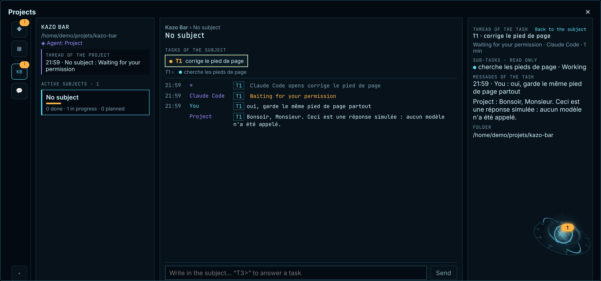

# Projects view

Work item `stage2/24-projects-view`. Decision: [ADR 0026](adr/0026-projects-subjects-and-their-threads.md),
sections 3, 5, 7 and 8; [ADR 0027](adr/0027-orb-gestures.md) for the double click. This first work item
**reads** the task board and the catalog of projects. Work item `stage2/26-subject-thread-writing` adds
writing in the thread of a subject (section 4).

## What the user sees

- **A double click on the orb** opens the view, over the whole screen on Windows. It opens again where the
  user left it, as long as Jarvis runs.
- **The rail**, on the left: ◆ "To handle" with the number of tasks that wait, ▦ "All projects", one entry per
  project (two letters and its number that waits), 💬 "General", and "+" which opens the "Projects" page of the
  settings.
- **"To handle"** lists the tasks that wait for the user, all projects together, the oldest first. A click
  opens the project, the subject and the thread of the task.
- **"All projects"** shows one card per project: what waits, up to three tasks in progress with the progress of
  their sub-tasks, the last word. A folder where a session works with no project has its card, which opens the
  "Projects" page.
- **The panel of the project**: its folder, the thread of the project (the last word of its subjects), the
  active subjects with their done / in progress / planned bar, then the subjects ended in the last seven days.
- **At the centre**, the subject: the path Project › Subject, the band of tasks numbered `T1`, `T2`… (✓ done,
  ● in progress, ○ planned, ✕ stopped; amber when it waits), the sub-tasks of the tasks in progress on one
  line, then the thread of the subject. "Show all" unfolds the band beyond six tasks; a task in progress always
  stays visible.
- **On the right**, the thread of the open task (status, who works, duration, summary, read-only sub-tasks,
  folder); otherwise "Find", which searches the titles and the summaries of the tasks of the project.

## Where the projects, the subjects and the tasks come from

`ProjectsOverview.From(tasks, catalog)` is a pure function, with no clock and no storage.

| Level | Rule |
| --- | --- |
| Project | The one of the catalog that holds the folder of the task (`IProjectCatalog.OwnerOf`). Every project of the catalog is shown, even with no task |
| General | Built-in project, always last: any task whose folder belongs to no project |
| Subject | In a project: the topic of the task (`WorkTask.Topic`, so the branch). In General: the project key of the task (the repository or the name of the folder), otherwise its topic |
| Task | A task of the board with no parent task, numbered in the order of creation in its subject |
| Sub-task | A task whose parent task exists; never a task of the subject |

`Pending` is "planned", `Done` "done", `Abandoned` "stopped", everything else "in progress". A subject is ended
when all its tasks are done or stopped.

**The thread of the subject** mixes, oldest first, computed lines (one when each task starts, one when it
ends with its summary, one when it waits for the user) and the messages written in the thread.

## Writing in the thread of a subject

Work item `stage2/26-subject-thread-writing` (ADR 0026, section 4).

- Under the thread, an input line. The message leaves as an ordinary typed request (`TextSubmitted`), with
  the address of the thread: `ThreadAddress(Project, Subject, Task, TaskLabel, TaskTitle)`.
- **`T3> oui, on fait comme ça`** answers the task `T3` of the subject (`SubjectAnswer.Parse`): the prefix is
  removed, the message carries the tag `T3` in the thread and also shows in the thread of the task. A task the
  subject does not have is refused and the text stays in the input.
- **Who answers.** In a project of the catalog, the "Projet" agent receives the request directly, with no
  hand-over, with the folder and the memory of the project, and one line that names the subject (and the task,
  with its title). In General, the Jarvis agent answers as in the conversation window, with the same line.
- **Where it is kept.** The turn goes to the journal of the conversation with its address
  (`ConversationTurn.Thread`). `ISubjectThreads` (kernel), held by the `Conversation/Dialogue` slice, gives the
  turns of a thread; the view does not reference the conversation. The same turn therefore also shows in the
  conversation window.
- The state of the assistant takes a text only at rest: during an answer, the view says to try again and keeps
  the text.

## Answering the session of a task (`T3>`)

Work item `stage2/27-answer-task-session` (ADR 0026, section 4; Benoit's answers of 23 November 2026). When
the message answers a task (`T3> …`), the conversation first asks
`IClaudeTasks.ContinueAsync(task, message, language)`:

| The task | What happens | What Jarvis says in the thread |
| --- | --- | --- |
| Session started by Jarvis, over (done or blocked) | The session is **resumed** with the message (`claude --resume <session>`), in the same folder, with the usual budget and cap. The same task goes back to "in progress" (`TaskChange.Reopen`), then ends like any other | "I am handing your answer to the Claude Code session of …" |
| Session started by Jarvis, still running | Nothing starts: in headless mode a session reads no message before it is done | It is still working; send the message again afterwards |
| Session started by hand (hooks) | Nothing: it is not a session of Jarvis | It cannot write to it; the message stays in the thread |
| Unknown session, folder no longer allowed, too many sessions, cap reached, Claude Code not found | Nothing | The cause |
| Another task (not a Claude Code session) | — | The local agent answers, as for a message to the subject |

In the first four cases no model is called: the sentence is fixed, the turn is kept with its address and a
hand-off entry to "Claude Code" (failure `NotContinued` when nothing is resumed). The message leaves **word
for word**, with no summary and no reminder of the project memory: the session already has its context. The
end of the resumed session is announced like the end of a new one.

Deviation: the task board never brought back a task that was over (ADR 0013). `TaskChange.Reopen` allows it,
asked only by `ClaudeTaskRunner` once the session runs again; a late hook still cannot. A resume that does not
start leaves the task as it ended.

## Offering to make a project of a subject of General

Work item `stage2/28-general-project-offer` (ADR 0026, sections 6 and 11, point 3).

- In the panel of "General", one card per subject that took **4 tasks or 30 messages in 7 days**
  (`ProjectOffer.For`, a pure function). It proposes a name (the one of the subject, editable) and a folder
  (the one most of its tasks work in) and says that the subject, its tasks and their threads are moved.
- **Create** calls `IProjectCatalog.CreateAsync(name, folder)` and opens the new project. **Change the
  folder** opens the "Projects" page. **Later** hides the offer for 7 days. **Refuse** never offers it again
  for this subject. Jarvis never creates a project by itself.
- A subject none of whose tasks has a folder is not offered: there is nowhere to make the project.
- The thresholds and the answers are in the settings section `Projects.View` (`ProjectsViewOptions`:
  `OfferTasks`, `OfferMessages`, `OfferDays`, `LaterDays`, `Refused`, `Later`).

**What is "moved".** The tasks follow by themselves: a task belongs to the project that holds its folder. The
messages keep the address they were written at; `ThreadHomes.HomeOf` says where to show them:

1. an answer to a task (`T3>`) is shown in the subject where that task is;
2. a message to the subject stays where it was written as long as that subject exists;
3. when the tasks of a subject of General left for a project, the message goes with the task that was the
   newest when it was written (the oldest one when it comes before them all).

Kernel: `IProjectCatalog.CreateAsync`, `ISubjectThreads.All`.

## "+ New subject"

Work item `stage2/29-new-subject` (ADR 0026, section 11, point 2).

- Under the active subjects of a project (and of "General"), "+ New subject" asks for a name. The subject
  exists at once, with no task, with its thread: one writes in it and the agent of the project answers.
- It is kept in the settings `Projects.View` (`UserSubject`: project, key `subject:<name>`, name, date). The
  key comes from the name, without accents, and stays unique in the project.
- **Its tasks.** A work handed to Claude Code from the thread of a subject of a project becomes a task of
  that subject: `ClaudeTaskRequest.Topic` carries the key of the subject, and the task is created with it.
  This holds for every subject of a project, not only those made by hand. In "General", the subject of a
  session stays its folder.
- A subject made by hand stays open while it has no task; afterwards it ends like the others, when all its
  tasks are done or stopped.

## Slice `Projects/View`

| File | Role |
| --- | --- |
| `ProjectsOverview` | Projects, subjects, tasks, lines of the thread, from the board and the catalog |
| `ProjectsViewState` | Entry of the rail, open subject and task; kept in memory |
| `ProjectsViewOpener` | Answers `ProjectsViewRequested`: opens the window `Projects.View` |
| `ProjectsView` | The Razor component, its CSS and its texts |
| `SubjectAnswer` | The prefix `T3>` of a message |
| `ProjectOffer`, `ProjectsViewOptions` | The offer to make a project, its thresholds, the refusals and the postponements |
| `ThreadHomes` | In which subject a message is shown today |
| `UserSubject` | A subject made by the user, and its key |

Kernel: `IProjectCatalog.OwnerOf`; `DialogRequest.Maximized`, which the Windows host applies to the window and
the Web host turns into a wider layer. The slice references neither `Projects/Catalog` nor `Tasks/Board`: it
goes through `IProjectCatalog`, `ITaskBoard` and `SettingsWindowRequested`.

## Provisional choices of this work item

To be confirmed by Benoit:

1. The view is an ordinary window opened maximized, with its title bar; not the status bar of the mock-up
   (model, sessions, spend, time).
2. It opens again on the last entry of the rail, forgotten when Jarvis stops; the first time on "All
   projects".
3. The name of a subject is the name of its branch; a task on the main branch goes to "No subject". No tag
   (PR, issue) and no chosen title yet.
4. In General, the tasks of one folder or repository make one subject.
5. "To handle" counts the tasks that wait. The badge of the orb counts the open requests for agreement: the
   two numbers may differ.
6. "+" and the card of a folder with no project open the "Projects" page of the settings.
7. "Find" searches the tasks of the open project only; no Ctrl+K.
8. The agent shown is always "Project" (ADR 0025: one project agent).
9. A message written in a thread is an ordinary turn of the conversation, tagged: there is no separate
   conversation per subject, and the conversation memory sees it like the others.
10. `T3>` sent to a session that still runs is refused with a sentence; the message is not queued to be
    handed over at the end.
11. No choice of the agent in the thread, and nothing by voice ("pour la tâche 3").
12. The thresholds of the offer are set in the settings file, not on a page yet.
13. "Later" means 7 days. "Change the folder" leads to the "Projects" page instead of a field in the card.
14. A message written to the subject of General (with no `T3>`) follows, once the project is created, the
    task that was the newest when it was written.
15. The offer is shown only in the panel of "General"; Jarvis does not say it aloud and the orb does not
    signal it.
16. A subject made by hand cannot be renamed or removed yet (the archives are not built); a subject of a
    project that was removed is no longer shown but stays in the settings.
17. A Claude Code session started **by hand** keeps the subject of its branch: only the works Jarvis starts
    from a thread take the subject of that thread.

## Not built yet

- Speaking in the thread of a subject, "pour la tâche 3" (section 4); the choice of the agent.
- The files of a task, the full log (section 5).
- The thread of the project as a conversation with the agent of the project (section 2).
- The archives; renaming or removing a subject (section 11).

## Not verified

- Nothing ran on Windows: the maximized window, the real double click and its delay.
- No real Claude Code session: the tasks come from the simulated sessions of the Web host. In particular,
  `claude --resume` with a message was never run for real from Jarvis.

## Tests

- Unit: `ProjectsOverviewTests` (grouping, numbers, thread, General, folder with no project);
  `SubjectAnswerTests` (prefix `T3>`); `ConversationEngineTests` (the "Projet" agent answers in the thread of a
  project, the line of the subject and of the task, the messages of a thread); `AssistantStateMachineTests`
  (the address follows the turn).
- Playwright: `ProjectsViewTests` (double click, session with no project, task that waits, project created
  from the view, message written in the thread of a subject and `T1>` to a session started by hand);
  `ClaudeTasksTests` (`T1>` resumes a session started by Jarvis that is over).
- `UserSubjectTests` (key, subject with no task, tasks of its key) and the Playwright scenario of the new
  subject (creation, message, work handed to Claude Code that becomes its task T1).
- `ProjectOfferTests` (thresholds, proposed folder, refusal, postponement, messages that follow the tasks) and
  the Playwright scenario of the offer (four sessions over, creation, thread that follows, "Later").
- Unit tests of the resume: `ClaudeTaskRunnerTests` (resume, session still running, session started by hand,
  resume that fails) and `ConversationEngineTests` (no model called, the sentence, the fallback to the local
  agent).

## Windows checks

1. Double click on the orb: the view opens maximized; a single click still starts listening after the delay.
2. Start Claude Code in a folder of a project: the task appears in the project, under the subject of its
   branch.
3. A permission is asked: the rail and "To handle" count it, a click opens the thread of the task.
