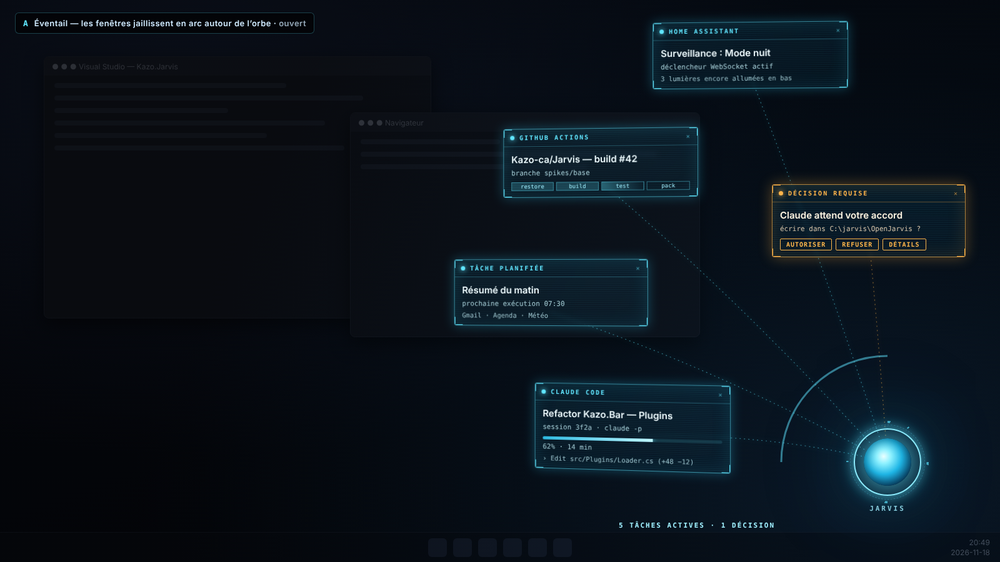
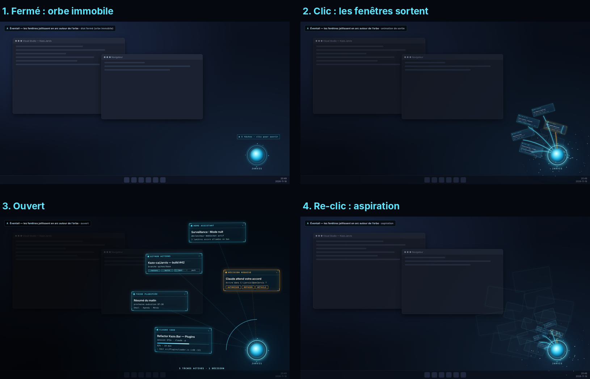
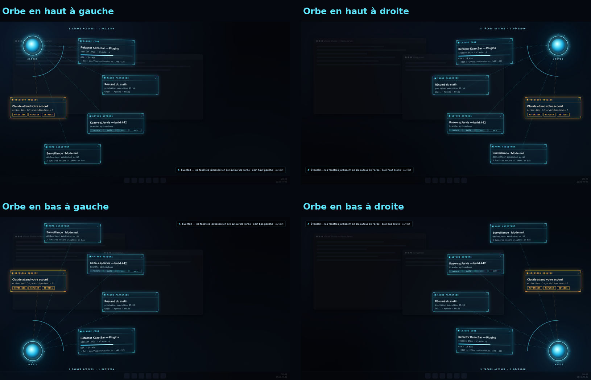

# ADR 0010 : éventail des tâches et clic sur l'orbe

## Statut

Proposé le 2026-11-19 (chantier `spikes/12-task-fan-adr`). En attente de l'accord de Benoit.

- **Sources :** demande de Benoit du 2026-11-19 (un clic sur l'orbe fait sortir les fenêtres des tâches en
  cours comme un hologramme, un second clic les y fait rentrer) ; son choix du même jour entre trois
  maquettes (éventail, orbite, projection) : **l'éventail**, sur l'ordinateur seulement, l'orbe dans
  n'importe quel coin de l'écran ; décisions n° 4, 15,
  18, 24 et 29 de la [conception](../plans/design.md) ; récits US1.1, US1.6, US1.12, US2.9, US2.11, US2.15 et
  US3.2 ; essai E6 ([résultats](../../../../spikes/e6-orb-window/RESULTS.md)).
- **Remplace en partie :** [ADR 0005](0005-assistant-state-machine-and-orb-contract.md), pour ce que fait un
  clic sur l'orbe (section 3 ci-dessous). Le reste de l'ADR 0005 reste valable.
- **Complète :** [ADR 0003](0003-hosts-and-native-services.md) (fenêtres de l'hôte Windows) et
  [ADR 0009](0009-permission-and-confirmation-model.md) (demande de confirmation).

## Contexte

- À partir de l'étape 2, Jarvis fait travailler des tâches en arrière-plan : sessions Claude Code, puis
  tâches planifiées et déléguées. L'orbe en montre le nombre par des satellites (ADR 0005), pas le contenu.
- Benoit veut voir ces tâches en cliquant sur l'orbe, dans un affichage futuriste. Trois maquettes lui ont
  été présentées. Il a d'abord retenu la projection, puis l'éventail.
- L'ADR 0005 dit qu'un clic sur l'orbe active l'écoute (US1.6). Sa section 7 renvoie à cet ADR ce que fait
  un clic au-delà de l'activation.
- Essai E6 : dans une fenêtre WPF transparente, chaque image modifiée est recopiée par le processeur. Le
  budget en veille est de moins de 2 % d'un cœur. L'éventail couvre une surface bien plus grande que l'orbe :
  son coût n'est pas mesuré.
- L'ADR 0009 affiche une demande de confirmation près de l'orbe, avec les boutons Approuver et Refuser. Un
  clic sur le PC y est un canal fort.

## Décision

### 1. L'éventail

- **Ouverture.** Au clic sur l'orbe, les panneaux des tâches en cours jaillissent de l'orbe et se rangent en
  arc autour de lui, un panneau par tâche. Un trait pointillé relie chaque panneau à l'orbe.
- **Fermeture.** Un second clic sur l'orbe aspire les panneaux dans l'orbe.
- **Bureau assombri.** Pendant que l'éventail est ouvert, le bureau derrière est assombri.
- **Teintes.** Les panneaux sont cyan. Un panneau qui attend une décision est **ambre**, son trait aussi.
- **Compteur.** Près de l'orbe, une ligne donne le nombre de tâches et le nombre de décisions en attente.
- **Position.** L'orbe peut être dans n'importe lequel des quatre coins de l'écran (précision de Benoit du
  2026-11-19). L'éventail s'ouvre toujours vers le centre de l'écran. L'orbe se déplace librement (US1.1) :
  hors d'un coin, l'éventail prend la disposition du coin le plus proche.
- **Sans tâche en cours**, l'éventail s'ouvre quand même et le dit en une ligne.

### 2. Les panneaux

- Un panneau montre une tâche : d'où elle vient, son titre, son état et sa dernière activité.
- Les panneaux de la maquette sont des exemples. Les types de panneaux et leur contenu exact sont fixés par
  les ADR des étapes 2 et 3, avec les tranches qui produisent les tâches.
- **Panneau de décision.** C'est la demande de confirmation de l'ADR 0009, affichée dans l'éventail : son
  résumé, les boutons Autoriser et Refuser, et un bouton Détails qui montre le détail exact (chemin,
  commande, différences). Un clic sur ces boutons est un clic sur le PC, donc un canal fort. L'éventail
  n'ajoute aucune autre façon d'approuver, et la demande reste aussi affichée près de l'orbe quand
  l'éventail est fermé.
- Les panneaux ne sont pas des fenêtres de Windows. Ils sont dessinés ensemble, dans une seule surface.

### 3. Ce que fait un clic sur l'orbe

- **Un clic sur l'orbe ouvre ou range l'éventail. Il n'active plus l'écoute.**
- On parle à Jarvis par le mot d'éveil ou par le raccourci global. L'interruption (US1.12) et l'annulation
  de l'écoute se font de la même façon.
- Dans la table des transitions de l'ADR 0005, « Activation (mot d'éveil, raccourci, clic) » se lit
  « Activation (mot d'éveil, raccourci) », et « Raccourci ou clic » se lit « Raccourci ». La sortie « clic »
  du composant de l'orbe ne veut plus dire « activation » : elle veut dire « ouvrir ou ranger l'éventail ».
- **Tant que l'éventail n'est pas construit**, le clic garde le comportement de l'ADR 0005.
- L'éventail se range aussi par la touche Échap et par un clic sur le bureau assombri.
- **L'éventail n'est pas un état de l'assistant.** Ouvert ou fermé, il ne change ni la phase ni les
  conditions de l'ADR 0005. Jarvis peut écouter, réfléchir ou parler pendant que l'éventail est ouvert, et
  l'orbe garde son aspect.

### 4. Sur l'ordinateur seulement

- L'éventail existe dans l'hôte Windows.
- L'hôte Web de test l'affiche par-dessus la page, avec des tâches simulées : c'est là que Playwright le
  vérifie.
- Sur mobile, il n'y a pas d'éventail. La façon de montrer les tâches sur le téléphone est fixée par l'ADR
  du mobile, à l'étape 4.

### 5. Dans l'hôte Windows

- La fenêtre de l'orbe reste petite, comme le dit l'ADR 0003. Elle n'est pas agrandie pour l'éventail.
- L'éventail a sa propre fenêtre : transparente, sans bordure, au premier plan, sur l'écran où se trouve
  l'orbe. L'orbe reste visible par-dessus.
- **Fermé, l'éventail ne coûte rien** : aucun dessin, aucune minuterie. Le budget en veille de l'ADR 0005 se
  mesure éventail fermé et ne change pas.
- L'éventail est une tranche à part, distincte de celle de l'orbe. Elle reçoit le clic de l'orbe et la liste
  des tâches par des messages du noyau (ADR 0002). Son contrat natif (ouvrir et fermer la fenêtre de
  l'éventail) s'ajoute quand la tranche est construite.

### 6. Animation

| Situation | Règle |
| --- | --- |
| Ouverture et fermeture | Animation, au plus 30 images par seconde, de moins d'une seconde au départ. La durée se règle sur l'hôte réel. |
| Éventail ouvert | **Image fixe.** Aucun effet continu : ni balayage, ni flottement des panneaux. |
| Une tâche change (progression, nouvel état, nouvelle tâche) | Le panneau concerné est redessiné une fois, au plus une fois par seconde au départ ; l'intervalle est réglé par la mesure. |
| Mouvement réduit | Aucune animation : l'éventail apparaît et disparaît d'un coup. |

### 7. Un essai avant de construire

- Le coût d'une fenêtre transparente aussi grande n'est pas mesuré. Un essai (E11) le mesure au début de
  l'étape 2, avec la méthode de l'essai E6 :
  - le coût pendant l'ouverture et la fermeture, et la fluidité de l'animation ;
  - le délai entre le clic et la première image ;
  - le coût éventail ouvert et immobile, puis éventail fermé ;
  - le passage des clics : sur un panneau, sur le bureau assombri, sur l'orbe.
- L'essai dit aussi si la fenêtre est créée à chaque ouverture ou gardée cachée.
- Si l'animation ne tient pas sur l'hôte réel, un nouvel ADR dit quoi changer avant de construire.

### 8. Quand

- L'éventail se construit à l'étape 2, avec les premières tâches en arrière-plan (US2.9, US2.11).
- L'étape 1 n'en construit rien.

### 9. Ce que cet ADR ne décide pas

- **Les couleurs et le dessin de l'orbe lui-même** (ses six aspects). L'orbe des maquettes est indicatif.
  L'ADR de l'orbe, encore à écrire, fixe aussi les valeurs exactes du cyan et de l'ambre, et s'assure que
  l'ambre d'une décision ne se confond pas avec la teinte d'alerte de l'aspect « erreur ».
- **Comment l'orbe fermé signale une décision en attente.** L'ADR 0005 prévoit des satellites ; la maquette
  montre une étiquette « 5 tâches · clic pour ouvrir ».
- **Le ✕ des panneaux** de la maquette : fermer le panneau, ou annuler la tâche.
- **Que faire quand les panneaux ne tiennent pas tous dans l'arc.** La maquette en montre cinq.
- **Les autres écrans**, quand il y en a plusieurs.

## Conséquences

- Le récit US1.6 change : on active Jarvis par le raccourci global, plus par un clic. La décision n° 15
  (« mot d'éveil, raccourci clavier global, clic sur l'orbe ») et la décision n° 18 (interruption « par mot
  d'éveil, raccourci ou clic ») perdent le clic. La conception se met à jour quand cet ADR est accepté.
- Le clic sur l'orbe change de sens à l'étape 2, quand l'éventail arrive.
- Pendant que Jarvis parle, un clic sur l'orbe ne le fait plus taire : il faut le raccourci ou le mot d'éveil.
- L'hôte Windows a une deuxième fenêtre transparente à tenir, et un contrat natif de plus avec ses deux
  mises en œuvre.
- Une action critique (ADR 0009) peut être approuvée depuis le panneau ambre : c'est un clic sur le PC.
- **Risque :** si l'essai E11 montre que l'animation coûte trop cher ou saccade sur une grande fenêtre
  transparente, l'effet devra être réduit.
