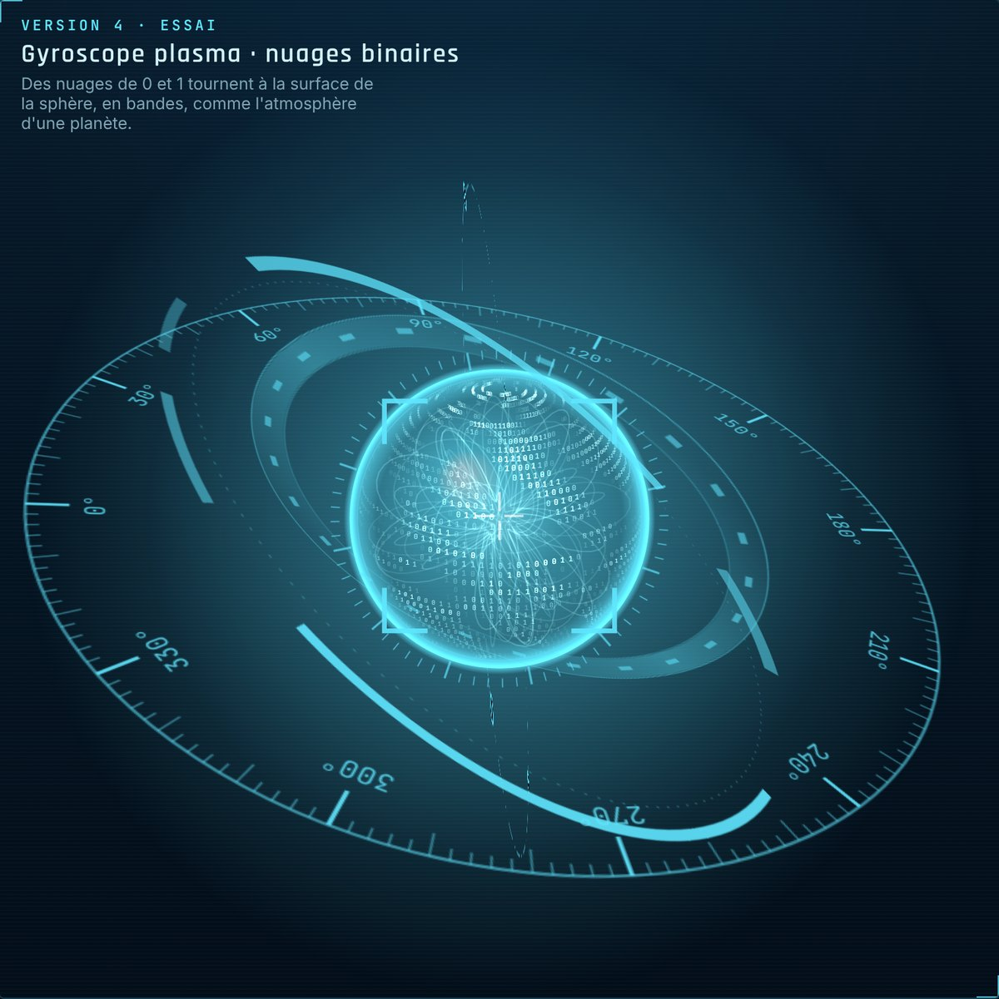
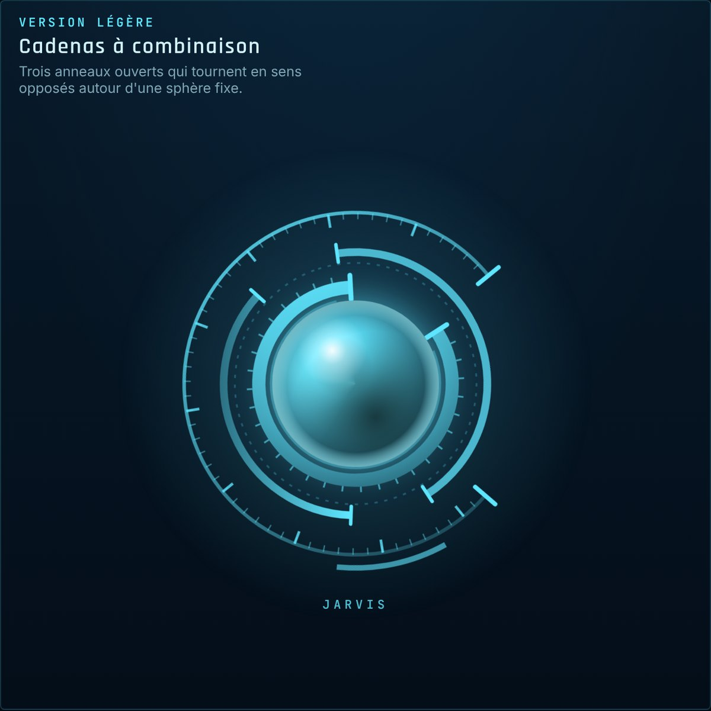

# ADR 0011 : dessin et couleurs de l'orbe

## Statut

Proposé le 2026-11-19 (chantier `spikes/14-orb-adr`), en attente de l'accord de Benoit.

- **Sources :** designs validés par Benoit le 2026-11-19 et décrits dans le
  [catalogue de l'interface](../ui/catalog.md) (orbe haute qualité : « c'est parfait » ; orbe légère sur son
  croquis : un cœur et trois anneaux ouverts) ; prototypes
  [`orb-high-quality.html`](../../../../design/prototypes/orb-high-quality.html) (mode 5) et
  [`orb-light.html`](../../../../design/prototypes/orb-light.html) ; ce que Benoit n'aime pas (pulsation de
  taille qui suit la voix, ondes de parole) ; décisions n° 5 et 6 de la [conception](../plans/design.md) ;
  essai E6 ([résultats](../../../../spikes/e6-orb-window/RESULTS.md)).
- **Complète :** [ADR 0005](0005-assistant-state-machine-and-orb-contract.md), qui renvoie à un ADR dédié
  « les couleurs et le dessin de l'orbe » (section 7), et [ADR 0010](0010-task-fan-and-orb-click.md), qui
  renvoie ici les valeurs du cyan et de l'ambre et le signal d'une décision en attente (section 9).
- **Remplace :** une seule phrase de l'ADR 0005, section 5 : « Son dessin est en Canvas 2D » (voir la
  section 2 ci-dessous). Le reste de l'ADR 0005 ne change pas.

## Contexte

- L'ADR 0005 fixe la machine à états, la fonction d'aspect (six aspects exclusifs et la superposition des
  tâches déléguées), les entrées et sorties du composant et la règle d'animation (image fixe en veille sur
  Windows). Il laisse le dessin et les couleurs à un ADR fait sur maquette.
- Le 2026-11-19, Benoit a validé deux orbes animés, une palette et le comportement de chaque état. Le
  catalogue les décrit ; les prototypes HTML sont les références visuelles.
- Les prototypes n'utilisent pas seulement Canvas 2D : la version haute qualité dessine ses anneaux en SVG
  avec des transformations CSS 3D, et la version légère n'a pas de toile du tout (dégradés CSS, SVG et Web
  Animations API).
- Le catalogue traite la « tâche longue » comme un huitième état coloré, alors que l'ADR 0005 en fait une
  superposition sur n'importe quel aspect. Il faut réconcilier les deux.
- Les prototypes laissent l'erreur tourner lentement (vitesse 0,25) et proposent d'animer la veille. Sur
  Windows, l'ADR 0005 demande une image fixe pour la veille, le micro coupé et l'erreur.
- Essai E6 : dans la fenêtre WPF transparente, toute image qui bouge coûte au moins 4 à 5 % d'un cœur, quelle
  que soit la technique de dessin ; seule l'image fixe tient sous 2 %.

## Décision

### 1. Deux versions, un seul composant

| Version | Image | Pour |
| --- | --- | --- |
| **Haute qualité** (par défaut) |  | Le PC de Benoit et toute machine avec une carte graphique |
| **Légère** |  | Les machines où la haute qualité coûte trop cher pendant les phases animées |

- Les deux versions sont dans le **même composant Razor** de la tranche de l'orbe (ADR 0005, section 5).
  Elles reçoivent les mêmes entrées et produisent les mêmes sorties. La version est une entrée de plus.
- Le choix est un réglage de la tranche de l'orbe, **« Qualité de l'orbe » : haute (par défaut) ou
  légère**, modifiable sans redémarrer.
- La version mise de côté (plasma et anneaux sans nuages) et les propositions écartées du catalogue ne sont
  pas construites.

### 2. Techniques de dessin

Cette section remplace la phrase « Son dessin est en Canvas 2D » de l'ADR 0005, section 5.

| Couche | Haute qualité | Légère |
| --- | --- | --- |
| Sphère | Canvas 2D : dégradé radial, 18 filaments en mode additif, cœur blanc, halo | Dégradés CSS empilés, fixes |
| Surface | Canvas 2D : nuages binaires planétaires (mode 5 du prototype) | Aucune |
| Anneaux | SVG avec transformations CSS 3D : cinq anneaux gyroscopiques et crochets de visée | SVG : trois anneaux ouverts |
| Mouvement | Une boucle d'images pour la toile et les anneaux | Web Animations API sur `transform`, vitesse par `playbackRate` |

- **Pas de WebGL.** Les deux versions tiennent sans lui, et l'essai E6 montre que le coût vient de la
  recopie de la fenêtre, pas du dessin.
- Tout le code de dessin est dans le `.razor.js` et le `.razor.css` du composant (AGENTS.md, section II).
  Le JavaScript ne fait que dessiner : aucune règle d'état n'y est écrite (ADR 0005).
- Les tracés SVG des anneaux sont générés une fois au chargement du composant, pas à chaque image.
- Le portage part des prototypes, sans leurs commandes de démonstration (boutons d'état, cases à cocher,
  anciens modes binaires 1 à 4).

### 3. Palette

Les couleurs sont des variables CSS définies une fois dans `Features/Shared/`, parce que l'orbe, l'éventail
(ADR 0010) et les fenêtres les utilisent tous.

| Jeton | Valeur | Usage |
| --- | --- | --- |
| `--jarvis-cyan` | `#5fe6ff` | Couleur de base : veille, écoute, parole, cadres |
| `--jarvis-violet` | `#a08cff` | Réflexion |
| `--jarvis-green` | `#5fffb0` | Tâches déléguées, terminé |
| `--jarvis-red` | `#ff5f6d` | Erreur |
| `--jarvis-amber` | `#ffb347` | Décision qui attend l'utilisateur |
| `--jarvis-grey` | `#7d8b99` | Micro coupé |
| `--jarvis-bg` | `#040a12`, halo `#0f3550` | Fond des fenêtres |
| `--jarvis-text` | `#d3f3fb`, secondaire `#7fa6b5` | Texte |

- **L'ambre ne se confond pas avec le rouge de l'erreur** (question de l'ADR 0010, section 9) : leurs teintes
  sont éloignées (environ 35° pour l'ambre, 355° pour le rouge), et surtout ils n'occupent pas la même place.
  Le rouge teinte **tout l'orbe** ; l'ambre n'apparaît que dans un **badge** et dans les panneaux de
  décision, jamais comme teinte de l'orbe.
- **Polices :** Rajdhani (titres), Inter (texte), JetBrains Mono (étiquettes et chiffres). Elles sont livrées
  avec l'application, dans `Features/Shared/`, et ne sont jamais chargées depuis Internet : rien ne sort de
  la machine pour afficher l'interface ([ADR 0009](0009-permission-and-confirmation-model.md), section 9).
  Les trois sont sous licence SIL Open Font License.

### 4. Les six aspects

Vitesse : multiplicateur de la rotation des anneaux (haute qualité / légère). « Windows » désigne l'hôte qui
active la règle « image fixe en veille » de l'ADR 0005.

| Aspect | Teinte | Vitesse | Ce qui bouge | Sur Windows |
| --- | --- | --- | --- | --- |
| Veille | cyan | 0 / 0 | Rien | Image fixe |
| Écoute | cyan | 0,8 / 1 | Rotation douce. Le niveau du micro **monte la lumière**, sans changer la taille | Animé |
| Réflexion | violet | 2,4 / 3,5 | Rotation rapide, sans lien avec le son | Animé |
| Parole | cyan | 1 / 1,2 | Haute qualité : la lumière suit la voix de Jarvis. Légère : chaque anneau pulse de son côté, au hasard (taille +2,5 à 7 %, 220 à 480 ms, toutes les 140 à 660 ms) | Animé |
| Erreur | rouge | 0 / 0 | Un éclair au passage, puis rien. La cause s'affiche au survol (ADR 0005) | Éclair, puis image fixe |
| Micro coupé | gris | 0 / 0 | Rien. Lumière baissée, mention « micro coupé » sous l'orbe | Image fixe |

- **Interdits, à la demande de Benoit :** une pulsation de taille qui suit la voix en écoute (effet
  d'avance-recul) et des ondes qui sortent de l'orbe pendant la parole.
- La seule exception à « pas de changement de taille » est la pulsation aléatoire des anneaux de la version
  légère en parole, que Benoit a demandée pour distinguer la parole de l'écoute.
- L'erreur ne tourne pas, contrairement aux prototypes (vitesse 0,25) : sur Windows elle doit être une image
  fixe (ADR 0005, section 6).
- La mention « micro coupé » et la cause de l'erreur sont des textes localisés de la tranche (ADR 0008).

### 5. Passage d'un aspect à l'autre

- La couleur et la vitesse passent de l'ancien aspect au nouveau **en fondu, en 0,3 à 0,6 s**, sans saut.
- Vers un aspect fixe (veille, micro coupé, erreur), le fondu se joue jusqu'au bout, puis **toute
  animation s'arrête** : plus de boucle d'images, plus de minuterie, plus d'animation Web en cours. Le
  fondu fait partie du « dessin au changement d'aspect » de l'ADR 0005 ; il dure moins d'une seconde.
- L'éclair de l'erreur fait partie de ce fondu.

### 6. Tâches déléguées (la superposition)

L'ADR 0005 garde la « tâche déléguée » comme superposition, pas comme aspect. Le « tâche longue » vert du
catalogue devient donc ceci :

- **Un nœud vert par tâche** sur l'anneau extérieur (la graduation en haute qualité, l'anneau extérieur en
  version légère). Au-delà de cinq, les nœuds s'arrêtent à cinq et une petite étiquette dit « +n ».
- **En veille avec des tâches**, l'orbe prend la teinte verte. Ailleurs, la teinte reste celle de l'aspect
  et seuls les nœuds sont verts.
- Sur Windows en veille, les nœuds sont dessinés immobiles et n'avancent que par pas, au plus une image
  toutes les 5 secondes au départ (ADR 0005, section 6). Pendant les phases animées, ils tournent avec leur
  anneau.
- **Une seule tâche qui donne sa progression** ajoute l'anneau de progression du prototype (arc vert et
  pourcentage). Avec plusieurs tâches, pas d'anneau de progression : les détails sont dans l'éventail.
- Rien de cela n'est visible avant l'étape 2, qui crée les premières tâches. La page de démonstration de
  l'étape 1 le montre avec des tâches simulées (US1.3).

### 7. Décision en attente

- Quand l'éventail est fermé, une décision en attente se signale par un **badge ambre avec le nombre de
  décisions**, en haut à droite de l'orbe, par-dessus n'importe quel aspect. Cela tranche la question
  laissée ouverte par l'ADR 0010, section 9 (satellites ou étiquette).
- Le badge ne clignote pas et ne s'anime pas : il apparaît et disparaît, et se redessine quand le nombre
  change. Il ne coûte rien en veille.
- Le badge compte les décisions seulement. Si le plein écran affiche un autre nombre (erreurs, terminés non
  lus), son ADR le dira.
- Comme les tâches, il n'est utile qu'à partir de l'étape 2 et figure dans la page de démonstration dès
  l'étape 1.

### 8. Veille animée

- **Pas de veille animée sur Windows dans la première version.** La règle de l'ADR 0005 reste.
- L'hôte Web garde une option « veille animée » pour la démonstration (vitesse 0,2 en haute qualité).
- Permettre une veille animée sur Windows demandera une mesure sur l'hôte réel et un nouvel ADR.

### 9. Mouvement réduit

- Aucun fondu, aucune rotation, aucune pulsation, aucun éclair : l'aspect change d'un coup.
- Les aspects se distinguent par la teinte, et par **une courte étiquette localisée sous l'orbe** pour ceux
  qui partagent le cyan : « écoute », « parole ». La réflexion (violet), l'erreur (rouge) et le micro coupé
  (gris, avec sa mention) se reconnaissent déjà à leur teinte.
- L'option suit le réglage d'accessibilité de Windows (`prefers-reduced-motion`) et peut être forcée dans les
  paramètres de la tranche.

### 10. Mesure avant de déclarer la tranche terminée

- Avec la méthode de l'essai E6, sur l'hôte Windows réel, **pour chacune des deux versions** :
  - veille, micro coupé et erreur : **moins de 2 % d'un cœur** (budget de l'ADR 0005, obligatoire) ;
  - écoute, réflexion et parole à 30 images par seconde : coût relevé et écrit dans la mémoire du projet. Il
    n'y a pas de seuil : l'ADR 0005 accepte le coût des phases animées.
- Si la version haute qualité saccade ou dépasse nettement la version légère, le choix par défaut se
  rediscute avec Benoit avant la fin de l'étape 1.

### 11. Ce que cet ADR ne décide pas

- **La taille de l'orbe à l'écran.** Elle se fixe dans la tranche de l'orbe, sur l'hôte réel.
- **L'orbe sur le téléphone.** Le même composant servira, mais sa règle d'animation et sa version par défaut
  sont fixées par l'ADR du mobile, à l'étape 4.
- **Le plein écran.** Il est décrit par le catalogue et aura son propre ADR quand il sera construit.

## Conséquences

- L'orbe a deux mises en œuvre visuelles à tenir dans un composant, et deux mesures de coût à refaire après
  chaque changement de dessin.
- Le cyan, l'ambre et les autres teintes sont fixés une fois pour l'orbe, l'éventail et les fenêtres. Les
  changer demande un nouvel ADR.
- La « tâche longue » du catalogue n'est plus un état : c'est une superposition verte, comme le veut
  l'ADR 0005. Les prototypes restent tels quels ; c'est cet ADR qui dit comment les lire.
- Les polices livrées avec l'application ajoutent quelques centaines de Ko au paquet.
- Le premier travail visuel de l'étape 1 est le portage de ces deux versions dans la tranche de l'orbe.
