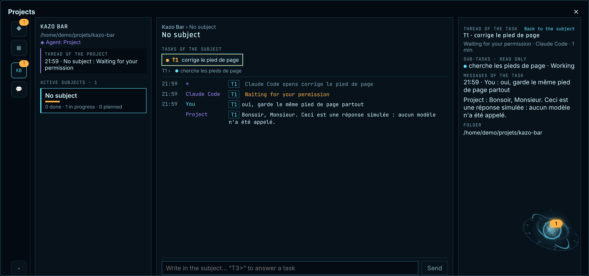

# Vue des projets

Chantier `stage2/24-projects-view`. Décision : [ADR 0026](adr/0026-projects-subjects-and-their-threads.md),
sections 3, 5, 7 et 8 ; [ADR 0027](adr/0027-orb-gestures.md) pour le double-clic. Ce premier chantier **lit**
le tableau des tâches et le catalogue des projets. Le chantier `stage2/26-subject-thread-writing` y ajoute
l'écriture dans le fil d'un sujet (section 4).

## Ce que voit l'utilisateur

- **Un double-clic sur l'orbe** ouvre la vue, en plein écran sur Windows. Elle rouvre là où l'utilisateur
  l'a laissée, tant que Jarvis tourne.
- **Le rail**, à gauche : ◆ « À traiter » avec le nombre de tâches qui attendent, ▦ « Tous les projets », une
  entrée par projet (deux lettres et son nombre en attente), 💬 « Général », et « + » qui ouvre la page
  « Projets » des réglages.
- **« À traiter »** liste les tâches qui attendent l'utilisateur, tous projets confondus, la plus ancienne
  d'abord. Un clic ouvre le projet, le sujet et le fil de la tâche.
- **« Tous les projets »** montre une carte par projet : ce qui attend, jusqu'à trois tâches en cours avec
  l'avancement de leurs sous-tâches, le dernier mot. Un dossier où une session travaille sans projet a sa carte,
  qui ouvre la page « Projets ».
- **Le panneau du projet** : son dossier, le fil du projet (le dernier mot de ses sujets), les sujets actifs
  avec leur barre faites / en cours / prévues, puis les sujets terminés depuis sept jours.
- **Au centre**, le sujet : le chemin Projet › Sujet, la bande des tâches numérotées `T1`, `T2`… (✓ faite,
  ● en cours, ○ prévue, ✕ arrêtée ; ambre quand elle attend), les sous-tâches des tâches en cours sur une
  ligne, puis le fil du sujet. « Tout voir » déplie la bande au-delà de six tâches ; une tâche en cours reste
  toujours visible.
- **À droite**, le fil de la tâche ouverte (statut, qui travaille, durée, résumé, sous-tâches en lecture
  seule, dossier) ; sinon « Retrouver », qui cherche dans les titres et les résumés des tâches du projet.

## D'où viennent les projets, les sujets et les tâches

`ProjectsOverview.From(tâches, catalogue)` est une fonction pure, sans horloge ni stockage.

| Niveau | Règle |
| --- | --- |
| Projet | Celui du catalogue qui tient le dossier de la tâche (`IProjectCatalog.OwnerOf`). Tous les projets du catalogue sont montrés, même sans tâche |
| Général | Projet intégré, toujours dernier : toute tâche dont le dossier n'appartient à aucun projet |
| Sujet | Dans un projet : le sujet de la tâche (`WorkTask.Topic`, donc la branche). Dans Général : la clé de projet de la tâche (le dépôt ou le nom du dossier), sinon son sujet |
| Tâche | Une tâche du tableau sans tâche parente, numérotée dans l'ordre de création dans son sujet |
| Sous-tâche | Une tâche dont la tâche parente existe ; jamais une tâche du sujet |

`Pending` est « prévue », `Done` « faite », `Abandoned` « arrêtée », tout le reste « en cours ». Un sujet est
terminé quand toutes ses tâches sont faites ou arrêtées.

**Le fil du sujet** mêle, du plus ancien au plus récent, des lignes calculées (une au début de chaque tâche,
une à sa fin avec son résumé, une quand elle attend l'utilisateur) et les messages écrits dans le fil.

## Écrire dans le fil d'un sujet

Chantier `stage2/26-subject-thread-writing` (ADR 0026, section 4).

- Sous le fil, une ligne de saisie. Le message part comme une demande tapée ordinaire
  (`TextSubmitted`), avec l'adresse du fil : `ThreadAddress(Projet, Sujet, Tâche, Étiquette, Titre)`.
- **`T3> oui, on fait comme ça`** répond à la tâche `T3` du sujet (`SubjectAnswer.Parse`) : le préfixe est
  retiré, le message porte l'étiquette `T3` dans le fil et apparaît aussi dans le fil de la tâche. Une tâche
  que le sujet n'a pas est refusée et le texte reste dans la saisie.
- **Qui répond.** Dans un projet du catalogue, l'agent « Projet » reçoit la demande directement, sans passage
  de main, avec le dossier et la mémoire du projet, et une ligne qui dit le sujet (et la tâche, avec son titre).
  Dans Général, l'agent Jarvis répond comme dans la fenêtre de conversation, avec la même ligne.
- **Où c'est gardé.** Le tour va au journal de la conversation avec son adresse (`ConversationTurn.Thread`).
  `ISubjectThreads` (noyau), tenu par la tranche `Conversation/Dialogue`, rend les tours d'un fil ; la vue ne
  référence pas la conversation. Le même tour se voit donc aussi dans la fenêtre de conversation.
- L'état de l'assistant n'accepte un texte qu'au repos : pendant une réponse, la vue dit de réessayer et garde
  le texte.

## Répondre à la session d'une tâche (`T3>`)

Chantier `stage2/27-answer-task-session` (ADR 0026, section 4 ; réponses de Benoit du 23 novembre 2026).
Quand le message répond à une tâche (`T3> …`), la conversation demande d'abord à
`IClaudeTasks.ContinueAsync(tâche, message, langue)` :

| La tâche | Ce qui se passe | Ce que dit Jarvis dans le fil |
| --- | --- | --- |
| Session lancée par Jarvis, terminée (faite ou bloquée) | La session est **reprise** avec le message (`claude --resume <session>`), dans le même dossier, avec le budget et le plafond habituels. La même tâche repasse « en cours » (`TaskChange.Reopen`), puis finit comme une autre | « Je transmets votre réponse à la session Claude Code de … » |
| Session lancée par Jarvis, encore en cours | Rien n'est lancé : en mode sans écran une session ne lit pas de message avant d'avoir fini | Elle travaille encore ; renvoyer le message après |
| Session lancée à la main (crochets) | Rien : ce n'est pas une session de Jarvis | Il ne peut pas lui écrire ; le message reste dans le fil |
| Session inconnue, dossier plus autorisé, trop de sessions, plafond atteint, Claude Code introuvable | Rien | La cause |
| Autre tâche (pas une session Claude Code) | — | L'agent local répond, comme pour un message au sujet |

Dans les quatre premiers cas aucun modèle n'est appelé : la phrase est fixe, le tour est gardé avec son
adresse et une entrée de passage de main vers « Claude Code » (échec `NotContinued` quand rien n'est repris).
Le message part **mot pour mot**, sans résumé ni rappel de la mémoire du projet : la session a déjà son
contexte. La fin de la session reprise est annoncée comme celle d'une session neuve.

Écart : le tableau des tâches ne ramenait jamais une tâche terminée (ADR 0013). `TaskChange.Reopen` le permet,
demandé seulement par `ClaudeTaskRunner` une fois la session relancée ; un crochet tardif n'y arrive toujours
pas. Une reprise qui ne démarre pas laisse la tâche telle qu'elle a fini.

## Tranche `Projects/View`

| Fichier | Rôle |
| --- | --- |
| `ProjectsOverview` | Projets, sujets, tâches, lignes du fil, d'après le tableau et le catalogue |
| `ProjectsViewState` | Entrée du rail, sujet et tâche ouverts ; gardés en mémoire |
| `ProjectsViewOpener` | Répond à `ProjectsViewRequested` : ouvre la fenêtre `Projects.View` |
| `ProjectsView` | Le composant Razor, son CSS et ses textes |

Noyau : `IProjectCatalog.OwnerOf` ; `DialogRequest.Maximized`, que l'hôte Windows applique à la fenêtre et que
l'hôte Web traduit par une couche plus large. La tranche ne référence ni `Projects/Catalog` ni `Tasks/Board` :
elle passe par `IProjectCatalog`, `ITaskBoard` et `SettingsWindowRequested`.

## Choix provisoires de ce chantier

À confirmer par Benoit :

1. La vue est une fenêtre ordinaire ouverte agrandie, avec sa barre de titre ; pas la barre d'état de la
   maquette (modèle, sessions, dépense, heure).
2. Elle rouvre sur la dernière entrée du rail, oubliée à l'arrêt de Jarvis ; la première fois sur « Tous les
   projets ».
3. Le nom d'un sujet est le nom de sa branche ; une tâche sur la branche principale va dans « Sans sujet ».
   Pas encore d'étiquette (PR, issue) ni de titre choisi.
4. Dans Général, les tâches d'un même dossier ou dépôt forment un sujet.
5. « À traiter » compte les tâches qui attendent. Le badge de l'orbe compte les demandes d'accord ouvertes : les
   deux nombres peuvent différer.
6. « + » et la carte d'un dossier sans projet ouvrent la page « Projets » des réglages.
7. « Retrouver » cherche dans les tâches du projet ouvert seulement ; pas de Ctrl+K.
8. L'agent affiché est toujours « Projet » (ADR 0025 : un seul agent de projet).
9. Un message écrit dans un fil est un tour ordinaire de la conversation, étiqueté : il n'y a pas une
   conversation séparée par sujet, et la mémoire de conversation le voit comme les autres.
10. `T3>` adressé à une session encore en cours est refusé avec une phrase ; le message n'est pas mis en
    attente pour être remis à la fin.
11. Pas de choix de l'agent dans le fil, et rien à la voix (« pour la tâche 3 »).

## Pas encore construit

- Parler dans le fil d'un sujet, « pour la tâche 3 » (section 4) ; le choix de l'agent.
- Les fichiers d'une tâche, le journal complet (section 5).
- Le fil du projet comme conversation avec l'agent du projet (section 2).
- « + Nouveau sujet », les archives (section 11).
- La proposition de faire un projet d'un sujet de Général (section 6).

## Non vérifié

- Rien n'a tourné sur Windows : la fenêtre agrandie, le double-clic réel et son délai.
- Aucune session Claude Code réelle : les tâches viennent des sessions simulées de l'hôte Web. En particulier,
  `claude --resume` avec un message n'a jamais été lancé pour de vrai depuis Jarvis.

## Tests

- Unitaires : `ProjectsOverviewTests` (regroupement, numéros, fil, Général, dossier sans projet) ;
  `SubjectAnswerTests` (préfixe `T3>`) ; `ConversationEngineTests` (l'agent « Projet » répond dans le fil d'un
  projet, la ligne du sujet et de la tâche, les messages d'un fil) ; `AssistantStateMachineTests` (l'adresse
  suit le tour).
- Playwright : `ProjectsViewTests` (double-clic, session sans projet, tâche qui attend, projet créé depuis la
  vue, message écrit dans le fil d'un sujet et `T1>` vers une session lancée à la main) ; `ClaudeTasksTests`
  (`T1>` reprend une session terminée lancée par Jarvis).
- Unitaires de la reprise : `ClaudeTaskRunnerTests` (reprise, session en cours, session à la main, reprise
  qui échoue) et `ConversationEngineTests` (aucun modèle appelé, la phrase, le repli sur l'agent local).

## Vérifications sur Windows

1. Double-clic sur l'orbe : la vue s'ouvre agrandie ; un clic simple lance encore l'écoute après le délai.
2. Lancer Claude Code dans un dossier de projet : la tâche apparaît dans le projet, sous le sujet de sa
   branche.
3. Une permission demandée : le rail et « À traiter » la comptent, un clic ouvre le fil de la tâche.
