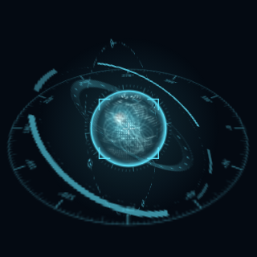
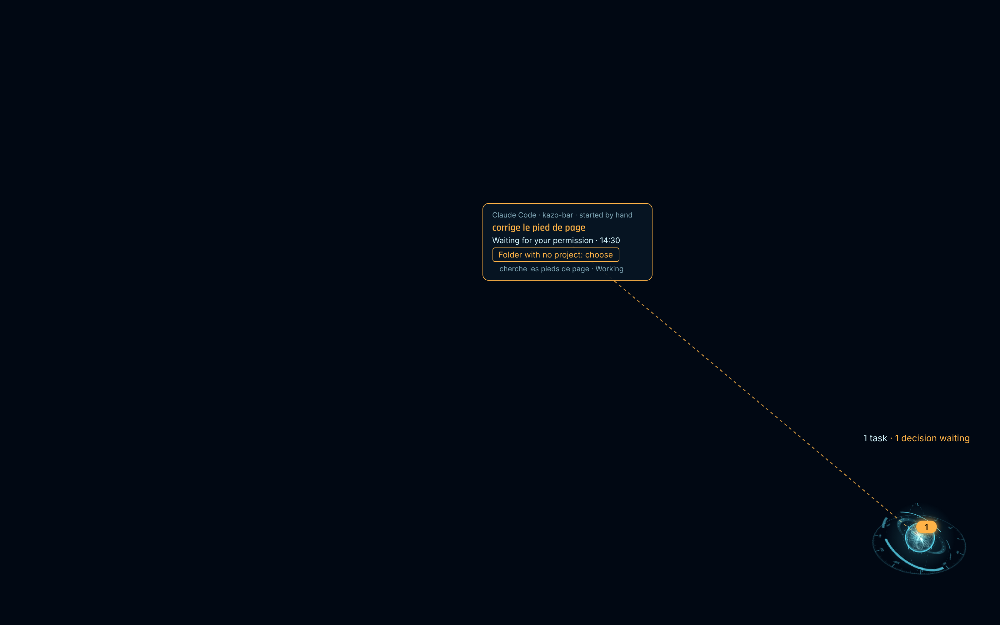
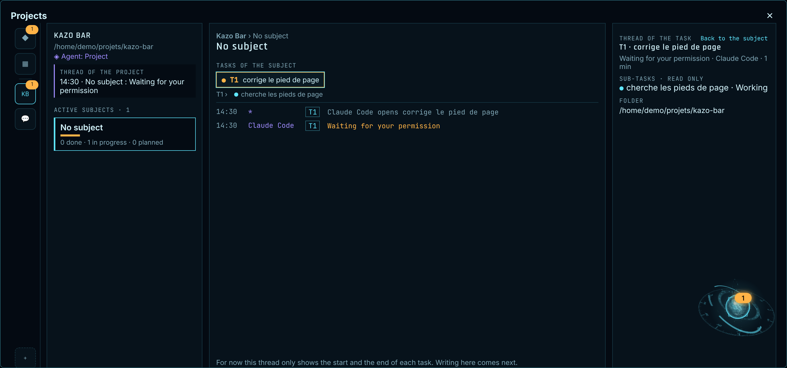

# Kazo.Jarvis

*[English version](README.md)*

Un assistant vocal pour Windows, écrit en C# sur .NET 10, sans Python à
l'exécution. Il prend la forme d'un orbe animé, répond d'abord avec un modèle
local, et passe la main à Claude quand la tâche le dépasse. Une application
Android permet de lui parler ailleurs que devant le PC.

> **En cours de conception.** Kazo.Jarvis est encore en conception et en construction. Rien n'est publié, et
> ce qui est construit change d'une semaine à l'autre. L'étape 1 (chaîne vocale, orbe, réglages) et la plus
> grande partie de l'étape 2 (outils, mémoire, sessions Claude Code, éventail des tâches, agents, projets) sont
> écrites ; une bonne part de l'étape 2 n'a pas encore tourné sur Windows. Voir la
> [vue d'ensemble du produit](doc/fr/features.md) pour l'état de chaque fonction.

Construire et tester : [doc/fr/dev/build.md](doc/fr/dev/build.md).

## Captures d'écran

Prises sur l'hôte de test, dont les services sont simulés ([comment](design/screenshots/README.md)). Les
textes y sont en anglais, la langue par défaut de cet hôte.

| L'orbe | L'éventail des tâches (clic droit sur l'orbe) |
| --- | --- |
|  |  |

La vue des projets (double-clic sur l'orbe) : un projet, son sujet, la bande des tâches et le fil d'une tâche.

## Pour aller plus loin

- Document de conception : [doc/fr/dev/plans/design.md](doc/fr/dev/plans/design.md)
- Vue d'ensemble du produit : [doc/fr/features.md](doc/fr/features.md)
- Essais techniques : [spikes/](spikes/README.md)
- Designs de l'interface et prototypes : [doc/fr/dev/ui/catalog.md](doc/fr/dev/ui/catalog.md), [design/](design/README.md)
- Règles pour les contributeurs et les agents : [AGENTS.md](AGENTS.md)
- Licence : [Apache 2.0](LICENSE)
